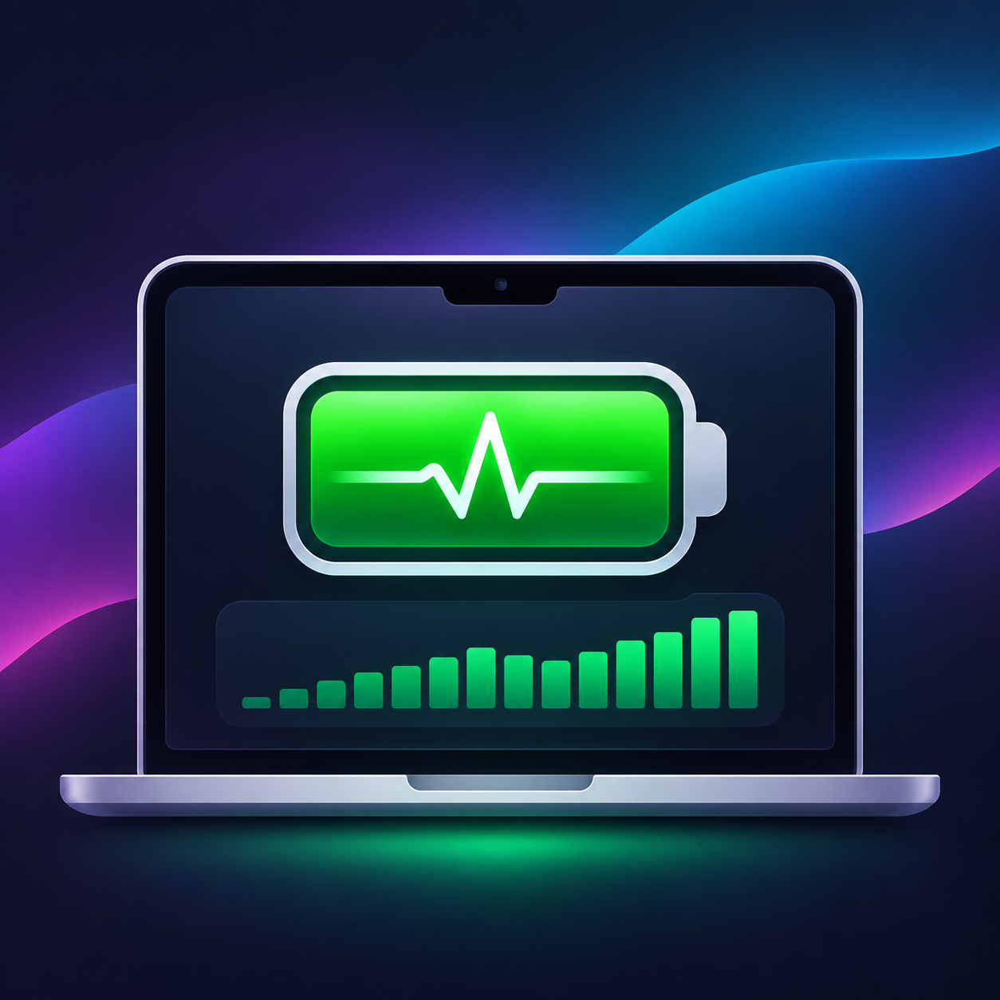
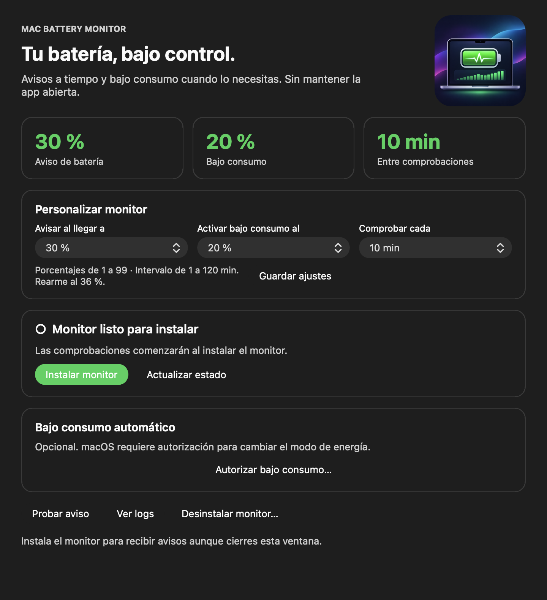

<p align="center">
  
</p>

<h1 align="center">Mac Battery Monitor</h1>

<p align="center">Avisos de batería y bajo consumo automático para tu Mac.</p>

<p align="center">
  
  
  
</p>

Una app nativa de macOS para instalar y gestionar un monitor ligero. `launchd` comprueba la batería con el intervalo que elijas, **cada 10 minutos por defecto**, aunque cierres la app, Terminal y VS Code. Sin Homebrew, Python ni paquetes externos para usarla.

Puedes elegir por separado el porcentaje del aviso y el de activación del bajo consumo, entre **1 % y 99 %**, y el tiempo entre comprobaciones, de **1 a 120 minutos**. Estos son los valores predeterminados:

| Batería | Qué sucede |
| --- | --- |
| **30 % o menos** | Un aviso para conectar el cargador. |
| **20 % o menos** | Activa el bajo consumo si autorizaste ese cambio. |
| **36 % o más** | Rearma las acciones para el siguiente ciclo con los valores predeterminados. |

Las acciones se aplican cuando el Mac usa batería. El estado persistente evita avisos repetidos; los errores tienen reintentos espaciados y logs rotativos. Durante reposo o con el equipo apagado no se ejecuta. La detección puede demorarse aproximadamente el intervalo elegido mientras está despierto, o más durante reposo.

## Instalar como app

1. Abre `Mac-Battery-Monitor-0.4.0-arm64.dmg` de la carpeta `dist/` después de compilar el paquete, o de una futura publicación en GitHub Releases.
2. Arrastra **Mac Battery Monitor.app** a **Applications**. También puedes copiarla a `~/Applications` para instalarla solo para tu usuario.
3. Si ya tenías una versión anterior, pulsa **Actualizar monitor** antes de guardar los nuevos ajustes.
4. En **Personalizar monitor**, elige los dos porcentajes y los minutos en **Comprobar cada**. Pulsa **Guardar ajustes** y, si es la primera instalación, **Instalar monitor**.
5. Permite las notificaciones cuando macOS lo solicite. Usa **Probar aviso** para comprobarlas.
6. Si quieres el cambio automático al porcentaje elegido, pulsa **Autorizar bajo consumo…**. La app explicará el permiso antes de pedir autenticación.

La app incluye controles para actualizar el monitor, consultar su estado, ver logs, retirar la autorización y desinstalarlo. Puedes cerrarla después de configurarlo.

Guardar los ajustes no requiere administrador. Se conservan al cerrar la app, reiniciar o actualizar el monitor. El intervalo actualiza la tarea de `launchd` y los porcentajes se usan en la próxima comprobación. Cambiar un umbral habilita un nuevo intento de su acción; cambiar solo el tiempo conserva la deduplicación. La app muestra el nivel de recarga necesario para rearmar el siguiente ciclo.

Si la tarea está activa, cambiar el intervalo la recarga; puede producirse una comprobación inmediata al hacerlo. Una tarea detenida permanece detenida. Si macOS rechaza la recarga, se intenta restaurar la configuración anterior y se informa del error.

<details>
  <summary>Ver la interfaz de la app</summary>
  <p></p>
</details>

**Estado de distribución:** la compilación local lleva firma ad hoc. Todavía no lleva firma Developer ID ni notarización de Apple; un paquete descargado de Internet puede ser bloqueado por Gatekeeper. Para distribución pública debe completarse el proceso descrito en [desarrollo y publicación](docs/development.md). No es necesario desactivar las protecciones de macOS. [Apple explica la notarización aquí](https://developer.apple.com/documentation/security/notarizing-macos-software-before-distribution).

## Compilar el instalable

Requiere un Mac con macOS 15 o posterior y las Command Line Tools de Xcode con Swift. La compilación no descarga dependencias ni instala servicios.

```bash
make check       # Pruebas, compilación y validación de la app
make package     # Genera .app, .dmg, .zip y checksums
```

Resultados:

```text
build/Mac Battery Monitor.app
dist/Mac-Battery-Monitor-0.4.0-arm64.dmg
dist/Mac-Battery-Monitor-0.4.0-arm64.zip
dist/Mac-Battery-Monitor-0.4.0-arm64.sha256
```

Apple Silicon es la arquitectura predeterminada. La opción `BUILD_ARCH=x86_64` permite compilar una variante Intel; esa variante requiere validación en su propio hardware.

## Alternativa por Terminal

Se mantienen los comandos de la versión anterior:

```bash
/bin/bash tests.sh
/bin/bash battery-monitor.sh --dry-run
/bin/bash install.sh
/bin/bash battery-monitor.sh --test-notification
```

La instalación por Terminal usa `osascript` para los avisos; la instalación desde la app incorpora un emisor nativo con identidad **Mac Battery Monitor**. La instalación normal del monitor no requiere administrador.

También puedes configurar porcentajes y minutos por Terminal, sin administrador:

```bash
# Aviso al 40 %, bajo consumo al 25 % y comprobaciones cada 15 minutos.
/bin/bash battery-monitor.sh --configure 40 25 15
/bin/bash battery-monitor.sh --show-settings
```

El comando anterior de dos porcentajes sigue funcionando y conserva el intervalo guardado: `--configure 40 25`.

El bajo consumo sí necesita autorización porque `pmset` modifica ajustes reservados a `root`. La regla opcional permite únicamente `/usr/bin/pmset -b lowpowermode 1`, para tu UID y con esos argumentos exactos. La app muestra esta explicación antes del diálogo de autenticación. El ajuste queda configurado para batería hasta que lo cambies en Ajustes del Sistema.

Consulta la [guía completa](docs/usage.md) para permisos por Terminal, logs, recuperación de errores y desinstalación.

## Estructura del repositorio

```text
.github/                 CI y plantillas de issues/PR
Sources/MacBatteryMonitor/ Interfaz AppKit y notificaciones nativas
Resources/               Metadatos del bundle de macOS
scripts/                 Monitor, instalación, permisos y empaquetado
tests/                   Pruebas de lógica, instalación y bundle
docs/                    Guías e imagen original del proyecto
Makefile                 Comandos de desarrollo
VERSION                  Versión de la distribución
```

Los scripts de la raíz son accesos de compatibilidad. Los archivos generados en `build/` y `dist/` no se incluyen en Git; los paquetes se adjuntan a GitHub Releases cuando decidas publicar.

## Contribuir

Lee [CONTRIBUTING.md](CONTRIBUTING.md), el [historial de cambios](CHANGELOG.md) y la [guía de desarrollo](docs/development.md). El workflow de GitHub valida las pruebas y compila la app sin instalar tareas en el equipo del runner.

El código se distribuye bajo [MIT](LICENSE). La imagen aportada para el proyecto se conserva en `docs/assets/banner.png`; sus derechos permanecen con su autor y no se incluyen en la licencia del código.
